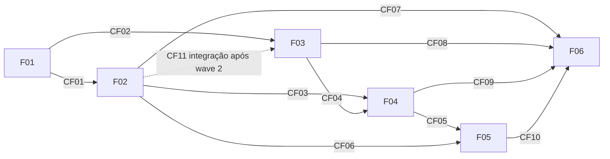

# PRD — Catraca

Fonte de verdade: [brief](brief.md). Regras de implementação: [arquitetura](architecture.md). Este PRD define o resultado; evidências devem registrar comportamento observado, nunca inferir aprovação a partir da existência de código.

## Escopo e atores

MVP local para eventos pequenos. Visitante consulta vitrine; participante registra nome/email/senha, entra/sai, compra um ingresso e consulta os próprios; organizadores vêm somente da seed e operam seus eventos; parceiro vende pela API autenticada por chave. Dinheiro em centavos, IDs strings e checkedIn separado do status. Gateway padrão simulado, sem credenciais reais.

## Features, provides e consumes

| ID | Feature | Provê | Consome | Wave |
|---|---|---|---|---|
| F01 | Harness, persistência e utilitários | Runtime Node 24 em container, banco SQLite/schema comum, transações, HTTP/utilitários de segurança, seed e comandos reproduzíveis. | Nenhuma feature. Requer Docker com Compose e Node.js LTS no host. | 1 |
| F02 | Contas, sessões e autorização | Cadastro exclusivo de participante, login/logout, sessão, currentUser e requireUser para os adapters. | F01: banco, seed, hashing, HTTP e transações. | 2 |
| F03 | Eventos e catálogo | Domínio independente de eventos, propriedade, criação/edição/publicação e catálogo com vagas. | F01: schema, transações e HTTP. Adapter HTTP consome F02 somente no ponto de integração após a wave paralela. | 2 |
| F04 | Compras, gateway e API de parceiros | Compra atômica, reservas, código único, preço histórico, gateway persistido, ingressos próprios e contrato de parceiros. | F02: participante autenticado; F03: eventos, catálogo e propriedade dos dados. F01 é infraestrutura transitiva. | 3 |
| F05 | Cancelamento, check-in e painel | Operações de gestão, cancelamento irreversível, entrada única e métricas consistentes. | F04: ingressos, preços e estados de ambos os canais; F02: autorização do organizador. | 4 |
| F06 | Interface e jornada integrada | Interface navegável do produto e evidências da jornada real ponta a ponta. | F02: contas/sessões; F03: eventos; F04: compras/ingressos; F05: operações/painel. | 5 |

## Grafo real de implementação e waves

1. Wave 1: F01 estabelece infraestrutura e interfaces.
2. Wave 2: F02 e F03 são implementadas **simultaneamente**, em worktrees/branches/PRs separados. O domínio de eventos recebe organizerId e não depende de autenticação. Depois de ambas integrarem, o adapter HTTP é conectado a requireUser e CF11 é validado. F03 só recebe aprovação integral após essa integração.
3. Wave 3: F04 integra compras, gateway e parceiros.
4. Wave 4: F05 integra as operações.
5. Wave 5: F06 integra interface e jornada completa.

Dependência de integração F02/F03 (CF11) aparece tracejada: seu contrato está congelado em F01, permitindo implementação simultânea; a integração e a avaliação de F03 aguardam F02. Bibliotecas de F01 são dependências transitivas compartilhadas. Não declarar integrações prontas antes de exercitá-las. Avaliações podem ocorrer depois de integrações necessárias, sem antecipar o status de concluída.

A prova da wave 2 são os commits reais dos PRs: primeiro commit de cada PR anterior ao último do outro. Cada agente deve produzir commits substantivos durante sua execução; não alterar timestamps. PRs permanecem visíveis e são listados no README.

## Critérios de aceite por feature

### F01 — Harness, persistência e utilitários

- **F01-AC01**: Um clone limpo sobe com `npm run up`, sem configuração extra, com produto em http://localhost:3000 e seed carregada.
- **F01-AC02**: `npm run down` encerra todos os serviços e portas iniciados; subir novamente funciona.
- **F01-AC03**: Seed cria dois organizadores e um participante, é idempotente e usa apenas credenciais demonstrativas.
- **F01-AC04**: `npm run gates` executa testes automatizados em ambiente isolado e passa na main.
- **F01-AC05**: Persistência fornece integridade de IDs/códigos, dinheiro inteiro e transações síncronas `BEGIN IMMEDIATE`; nenhum cartão completo é persistido.
- **F01-AC06**: AGENTS.md e README documentam comandos, pré-requisitos, mapa, endereços e credenciais; runtime além de Node fica em container; Windows é desenvolvido em WSL.

### F02 — Contas, sessões e autorização

- **F02-AC01**: Participante cria conta com nome, email e senha e consegue entrar e sair.
- **F02-AC02**: Cadastro nunca cria organizador, mesmo recebendo role malicioso.
- **F02-AC03**: /api/auth/me retorna {user:objeto|null}; senha/hash não aparece nas respostas; cookie de sessão é HttpOnly, SameSite=Strict e Path=/.
- **F02-AC04**: As três contas da seed autenticam com seus papéis e credenciais inválidas não autenticam.
- **F02-AC05**: requireUser bloqueia visitante com 401 e papel incorreto com 403; proteção vale no servidor (R13).

### F03 — Eventos e catálogo

- **F03-AC01**: Criar evento exige nome, início futuro, local, capacidade inteira ≥1 e preço em centavos positivo; evento nasce draft (R01/R02).
- **F03-AC02**: Edição revalida início futuro e não reduz capacidade abaixo de pending+confirmed; aumento é aceito (R01/R03/R05).
- **F03-AC03**: Somente published não cancelado aparece no catálogo, com preço e availableSeats corretos (R02/R05).
- **F03-AC04**: Propriedade é aplicada no domínio: lista só próprios e ownedEvent/update/publish não entregam dados de outro organizador (R13).
- **F03-AC05**: Evento cancelado não pode ser editado nem republicado (R11).
- **F03-AC06**: Cada evento pode ser obtido por ID para sua URL própria de gestão, sem vazar dados a outro papel/dono (R04/R13).

### F04 — Compras, gateway e API de parceiros

- **F04-AC01**: Uma compra válida retorna 202 pending sem aguardar gateway, com ticketId/code únicos, reserva vaga e preço vigente copiado (R03/R05/R06/R09).
- **F04-AC02**: Cartão exige exatamente 16 dígitos; inválido não cria ingresso; gateway padrão respeita resultados e faixas do brief (R08).
- **F04-AC03**: Lotação nunca é excedida; sem vaga responde 409 sold_out; duas rajadas em eventos novos de capacidade 5 dão exatamente cinco 202 e vinte e cinco 409 (R07).
- **F04-AC04**: Recusa muda pending→declined e libera vaga; aprovação muda pending→confirmed. Callback não altera cancelled/refunded nem evento cancelado (R08/R11).
- **F04-AC05**: As três rotas parceiras seguem campos/status e exigem chave antes de qualquer validação; compra valida corpo→evento→lotação.
- **F04-AC06**: API lista eventos elegíveis com campos fixos, compra retorna ticketId/code/status e consulta de qualquer canal retorna ticketId/code/eventId/status/checkedIn.
- **F04-AC07**: GET /api/tickets retorna somente ingressos da conta autenticada com evento/status/código; compra API não se associa a conta por email (R09).

### F05 — Cancelamento, check-in e painel

- **F05-AC01**: Organizador cancela somente próprio evento published; operação é irreversível e bloqueia venda/edição/republicação (R11/R13).
- **F05-AC02**: Em ≤10s confirmed vira refunded e pending vira cancelled; callbacks tardios mantêm os estados (R11).
- **F05-AC03**: Check-in respeita mensagens e prioridade literal de R10, inclusive código de outro evento e evento cancelado.
- **F05-AC04**: Entrada é concedida uma única vez e checkedIn permanece informação separada do status (R09/R10).
- **F05-AC05**: Painel agrega ambos os canais e preços históricos: confirmados, pendentes, check-ins, vagas, receita e estornados exatamente conforme R12.
- **F05-AC06**: Painel cancelado mostra 0 confirmados/pendentes/check-ins/vagas/receita e número correto de estornados (R05/R11/R12).
- **F05-AC07**: Todas as operações e métricas exigem dono; dados de evento alheio não vazam (R13).

### F06 — Interface e jornada integrada

- **F06-AC01**: Visitante vê vitrine apenas de eventos elegíveis; participante cria conta, entra e sai pela interface.
- **F06-AC02**: Checkout mostra pending e depois status/código/evento em Meus ingressos; esgotado exibe exatamente Ingressos esgotados (R06–R09).
- **F06-AC03**: Organizador cria/edita/publica em página de gestão de URL própria; erros de data/capacidade são visíveis e não alteram evento (R01/R03/R04).
- **F06-AC04**: Gestão apresenta painel, check-in e cancelamento com mensagens literais e ações bloqueadas após cancelar (R10–R12).
- **F06-AC05**: Acesso direto à gestão alheia não renderiza nome/números/ingressos para organizador B, participante ou visitante (R13).
- **F06-AC06**: Dados não confiáveis são renderizados como texto; navegação funciona em reload de URL direta e status usa rótulos PT-BR.
- **F06-AC07**: Fluxo oficial completo passa na main em clone limpo e gera evidências reais, incluindo UI, API, concorrência, restart e artefatos.

## Critérios cross-feature

Cada aresta tem um critério e um contrato consumidor que o verifica. CF11 cobre também a integração diferida da wave paralela.

| Critério | Relação | Aceite observável | Contrato responsável |
|---|---|---|---|
| CF01 | F01 → F02 | Seed e utilitários sustentam login das três contas com papéis corretos. | [F02](features/F02/contract.md) |
| CF02 | F01 → F03 | Schema e transação sustentam criação/publicação e rejeição atômica de redução abaixo da ocupação. | [F03](features/F03/contract.md) |
| CF03 | F02 → F04 | Sessão de participante vincula apenas compras da vitrine à conta; visitante/papel incorreto não compra pelo endpoint autenticado. | [F04](features/F04/contract.md) |
| CF04 | F03 → F04 | Evento draft não vende, publicado vende com preço vigente e capacidade respeitada; catálogo e compra concordam. | [F04](features/F04/contract.md) |
| CF05 | F04 → F05 | Ingressos dos dois canais contam igualmente no painel/check-in/cancelamento; callback lento não reverte cancelamento. | [F05](features/F05/contract.md) |
| CF06 | F02 → F05 | Autorização protege operações e painel de visitante, participante e organizador não dono. | [F05](features/F05/contract.md) |
| CF07 | F02 → F06 | Cadastro/login/logout da interface refletem sessão real e não permitem escolha de organizador. | [F06](features/F06/contract.md) |
| CF08 | F03 → F06 | Formulários e URL de gestão operam eventos reais e preservam isolamento e validações do domínio. | [F06](features/F06/contract.md) |
| CF09 | F04 → F06 | Checkout/Meus ingressos exibem pending, confirmação/código e esgotado com a mesma lotação da API. | [F06](features/F06/contract.md) |
| CF10 | F05 → F06 | Gestão apresenta mensagens e métricas reais, cancela irreversivelmente e bloqueia edição após cancelamento. | [F06](features/F06/contract.md) |
| CF11 | F02 → F03 (integração diferida) | Após integrar a wave 2, o adapter HTTP de eventos exige organizador e propriedade; domínio F03 permanece implementável sem F02. | [F03](features/F03/contract.md) |

## Avaliação e conclusão

Cada contrato requer agente novo de contexto vazio, distinto do implementador, com acesso ao brief, contrato e checkout do commit avaliado. Cada item recebe PASS/FAIL/NOT RUN/BLOCKED, evidência e observação. Relatório contém data UTC, commit, ferramenta, modelo efetivo e identidade/papel do avaliador. Relatórios são append-only: após commit nunca editar; correção exige relatório novo. Estado lista último relatório real e só marca completed quando todos os itens aprovam. Os relatórios de features não substituem a execução final dos 18 passos do avaliador na main em clone limpo, incluindo auditoria de Git/PRs/artefatos.

## Fora de escopo

Deploy e ambientes além do local; pagamento real, email/notificações; app mobile; avaliação de design; cadastro público de organizador; múltiplos ingressos por compra; mapa de assentos; cancelamento/transferência de ingresso pelo participante; atualização em tempo real. Fuso é livre e testes usam datas com pelo menos um dia de folga. Não implementar estas funções como atalhos ou pré-requisitos.

O HTML didático é material complementar solicitado pelo aluno; não substitui os artefatos acadêmicos. Métricas e evidências devem refletir execução real.

